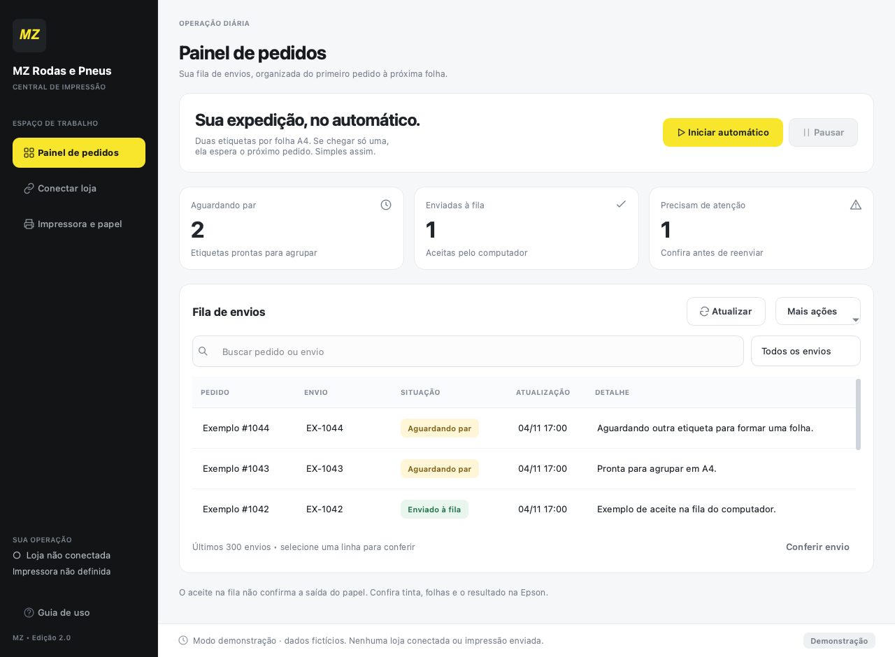
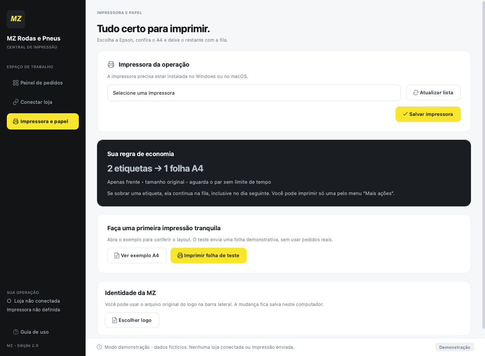

<p align="center">
  
</p>

<h1 align="center">MZ · Central de Impressão</h1>

<p align="center">
  Da venda à fila de impressão, com duas etiquetas por folha A4.
  <br>
  Aplicativo desktop integrado ao Mercado Livre para a operação da MZ Rodas e Pneus.
</p>

<p align="center">
  <strong>Python</strong> · PySide6 · SQLite · OAuth 2.0 + PKCE
  <br>
  macOS e Windows · Epson L3250 · Papel A4
</p>

<p align="center">
  <a href="#o-aplicativo">Interface</a> ·
  <a href="#funcionalidades">Recursos</a> ·
  <a href="#instalação">Instalação</a> ·
  <a href="#configuração">Configuração</a> ·
  <a href="#testes">Testes</a>
</p>

---

## Menos etapas na expedição

Baixar etiquetas e organizar os arquivos em pares faz parte da rotina de muitas lojas. A Central de Impressão reúne esse trabalho em uma fila: acompanha novos pedidos, aguarda a liberação das etiquetas e prepara a folha para a impressora escolhida.

Quando só há uma etiqueta, ela fica salva aguardando o próximo par, inclusive entre sessões. O operador também pode conferir a prévia ou imprimir uma etiqueta individualmente.

| Acompanhar | Organizar | Imprimir |
| :--- | :--- | :--- |
| Consultar novos pedidos e envios pela API. | Manter a fila salva e agrupar as etiquetas em pares. | Compor o PDF A4 e enviar à fila do sistema operacional. |

## O aplicativo

### Painel de pedidos

Fila de envios, busca, filtros e acompanhamento dos trabalhos em uma única tela.



<details>
<summary><strong>Ver configurações de impressora e papel</strong></summary>

Seleção da impressora, prévia A4, impressão de teste e personalização do logo.



</details>

*Capturas do modo de demonstração, com dados fictícios e sem pedidos de clientes.*

## Funcionalidades

- Integração com a API do Mercado Livre por OAuth 2.0 e PKCE.
- Renovação de tokens e armazenamento de credenciais no cofre do sistema operacional.
- Fila persistente em SQLite, identificada pelo código do envio.
- Composição de duas etiquetas em A4 com preservação do conteúdo do PDF.
- Busca, filtros, prévia e impressão manual de uma etiqueta.
- Conferência manual em falhas cujo resultado de impressão seja incerto.
- Interface Qt para macOS e Windows.

## Tecnologias

Python, PySide6, SQLite, pypdf, pypdfium2, Pillow, ReportLab e keyring. No macOS, a impressão usa CUPS; no Windows, usa o driver instalado por meio de pywin32.

## Instalação

Requer Python 3.10 ou superior. O ambiente validado usa Python 3.13, macOS e Epson L3250. O adaptador para Windows está incluído; a impressão física nessa plataforma deve ser validada no equipamento de uso.

### macOS

Execute `Instalar-Mac.command` e aguarde a instalação das dependências. Depois abra `Iniciar-Mac.command`.

O instalador cria um ambiente isolado em `runtime-mac`. Em instalações do Python que ainda não tenham certificados HTTPS configurados, execute `Install Certificates.command` na pasta do Python em Aplicativos.

### Windows

Instale o Python com o Python Launcher (`py`). Execute `Instalar-Windows.bat` e depois `Iniciar-Windows.bat`.

## Configuração

1. Cadastre um aplicativo no DevCenter do Mercado Livre, com Authorization Code, Refresh Token, PKCE e permissões de leitura de vendas e envios.
2. Configure um endereço HTTPS de retorno sob seu controle.
3. Na tela **Conectar loja**, informe App ID, Client Secret e o mesmo endereço de retorno.
4. Autorize a conta principal no navegador e conclua a conexão no aplicativo.
5. Instale a impressora no sistema operacional, selecione-a em **Impressora e papel** e faça uma impressão de teste.
6. Ative o acompanhamento no painel de pedidos.

A página de retorno deve permitir copiar a URL completa, incluindo os parâmetros `code` e `state`, para o aplicativo. Ela não recebe o Client Secret nem troca tokens. A validação da sessão acontece no aplicativo local.

O programa acompanha pedidos criados após a primeira conexão. Começa pausado a cada abertura e consulta a loja a cada 60 segundos quando o modo automático está ativo.

## Estrutura

```text
imprimedois/
├── app.py         Interface e eventos da aplicação
├── theme.py       Tema, ícones e componentes visuais
├── worker.py      Processamento das tarefas em segundo plano
├── mercado.py     Autenticação e consultas à API
├── storage.py     Configuração, persistência e controle de instância
├── engine.py      Fila, composição e envio dos lotes
├── layout.py      Montagem das etiquetas em A4
└── printer.py     Integração com as filas de impressão
```

## Testes

```sh
# macOS
runtime-mac/bin/python -m unittest discover -p 'testes*.py' -v
```

```bat
REM Windows
.venv\Scripts\python.exe -m unittest discover -p "testes*.py" -v
```

A suíte cobre fila e recuperação de falhas, PDFs, validação OAuth, diagnóstico de conexão, comandos de impressão e interação com a interface. As integrações externas são simuladas nos testes: a execução da suíte não acessa a loja nem envia impressões reais.

## Dados locais

| Sistema | Diretório |
|---|---|
| macOS | `~/Library/Application Support/ImprimeDois` |
| Windows | `%LOCALAPPDATA%\ImprimeDois` |

Configuração, fila e PDFs ficam nesse diretório. Client Secret e tokens ficam no cofre do sistema, por meio de keyring. As credenciais não devem ser versionadas. Os PDFs podem conter dados de compradores e exigem uma política de retenção definida pela operação.

Use uma instância e um computador por loja. As filas não são sincronizadas entre computadores.

## Comportamento de impressão

O status **Enviado à fila** confirma que o sistema operacional aceitou o trabalho. Não comprova saída física do papel nem despacho. Trabalhos com resultado incerto exigem conferência antes de reenviar.

A etiqueta precisa estar liberada pelo Mercado Livre. A aplicação não emite nota fiscal nem imprime etiquetas de despacho gerenciadas pelo Full. PDFs com várias páginas ou conteúdo que exceda o espaço disponível sem redução relevante são separados para conferência.

## Referências

- [Autenticação do Mercado Livre](https://developers.mercadolivre.com.br/autenticacao-e-autorizacao)
- [Etiquetas do Mercado Envios](https://developers.mercadolivre.com.br/pt_br/api-docs-pt-br/mercado-envios-2)
- [Qt for Python](https://doc.qt.io/qtforpython-6/)

As informações sobre bibliotecas de terceiros estão em `BIBLIOTECAS.txt`.
